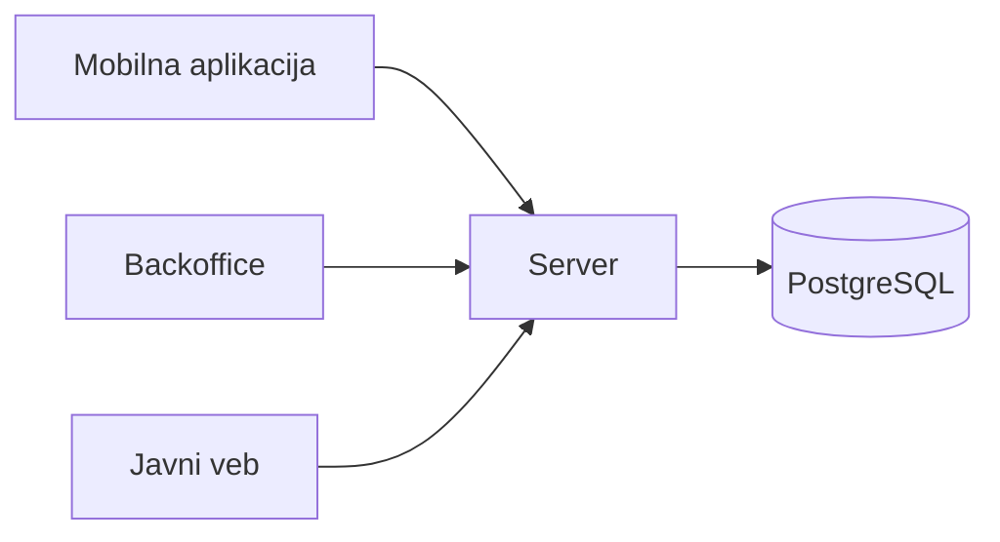

# Rafstoran

Sistem za rezervacije u restoranu. Gosti rezervišu sto preko mobilne aplikacije, a osoblje vodi rezervacije i raspored stolova iz backoffice aplikacije. Meni, radno vreme i slobodni termini javno su dostupni na vebu.

Primer sa vežbi iz predmeta Razvoj multiplatformskih aplikacija.

## Tim

| Ime i prezime | Broj indeksa | GitHub nalog |
| --- | --- | --- |
| Luka Petrović | — | [@github-nalog](https://github.com/github-nalog) |
| Nikola Paunović | — | [@github-nalog](https://github.com/github-nalog) |

U projektima studenata tabela sadrži oba člana tima, sa brojem indeksa.

## Zahtevi za temu

1. **Uloge.** Sistem koriste gosti i osoblje restorana, konobari i menadžer, sa različitim ovlašćenjima: gost upravlja samo svojim rezervacijama, a osoblje vidi sve.
2. **Stanja.** Rezervacija prolazi kroz više stanja: čeka potvrdu, potvrđena je, a zatim gost stiže, ne dolazi ili je rezervacija otkazana.
3. **Pravila.** Rezervacija je za najviše 12 osoba i otkazuje se najkasnije 2 sata pre termina. Isti sto ne može biti dvaput rezervisan u isto vreme; to zavisi od rezervacija drugih gostiju, pa konačno odlučuje server.
4. **Rad bez mreže.** Gost vidi svoje rezervacije i može da ih otkaže i bez signala; otkazivanje se šalje kada se veza vrati.
5. **Posao za osoblje.** Osoblje svakog dana radi sa rasporedom svih stolova i rezervacija, što je posao za veći ekran.
6. **Javni sadržaj.** Meni, radno vreme i slobodni termini zanimaju i one koji još nisu gosti, pa ima smisla da ih pronađu pretraživači.

## Delovi sistema

| Deo | Korisnici | Tehnologija | Platforme |
| --- | --- | --- | --- |
| Mobilna aplikacija | gosti | Flutter | Android |
| Backoffice | konobari, menadžeri | Flutter | Windows, veb |
| Javni veb | svi posetioci | Jaspr | pregledač |
| Server | ostali delovi sistema | Relic, PostgreSQL | Linux |
| Domenski paket | svi delovi sistema | Dart | sve |

Svi delovi koriste isti domenski paket, u kome su model i pravila. Server čuva podatke i ponovo proverava svako pravilo.



## Stanje projekta

Opis sistema. Detaljan opis domena i kod dodaju se tokom semestra.

## Pokretanje

Potrebni su Docker (Docker Desktop na Windows-u i macOS-u) i Flutter 3.47.6.

### Baza i server

Iz korena repozitorijuma:

```sh
cp .env.example .env    # Windows: copy .env.example .env
docker compose up -d
```

`compose.yaml` podiže tri servisa:

| Servis | Šta radi | Adresa |
| --- | --- | --- |
| `db` | PostgreSQL 17 | `localhost:5435` |
| `migrate` | dbmate primeni migracije iz `apps/server/migrations`, pa izlazi | — |
| `server` | server u Dartu na Relic-u, slika iz `apps/server/Dockerfile` | http://localhost:8080 |

Lozinka baze i portovi su u `.env`, koji nije u git-u. Ako je port zauzet, promenite `POSTGRES_PORT`, `SERVER_PORT` ili `ADMINER_PORT` u `.env`. Kada je baza prazna, server upisuje početne podatke.

Provera: `docker compose ps -a` (servis `migrate` je `Exited (0)`) i `curl localhost:8080/health` (odgovor `ok`; u PowerShell-u `curl.exe`).

| Komanda | Šta radi |
| --- | --- |
| `docker compose logs server` | ispis servera; `logs migrate` za migracije |
| `docker compose up -d --build server` | nova slika servera posle izmene u `apps/server` ili u paketima |
| `docker compose down` | gasi sistem, podaci ostaju |
| `docker compose down -v` | gasi sistem i briše bazu; sledeći `up -d` kreće od nule |

Baza u pregledaču: `docker compose --profile tools up -d adminer`, pa http://127.0.0.1:8082 (prijava ide sama, podacima iz `.env`). SQL iz terminala: `docker compose exec db psql -U rafstoran -d rafstoran`.

Server bez kontejnera, za debugger i brži restart:

```sh
docker compose stop server
cd apps/server
dart run bin/server.dart    # Ctrl+C zaustavlja
```

Testovi servera traže pokrenutu bazu i rade nad posebnom bazom `rafstoran_test`: u `apps/server` pokrenuti `dart test`.

### Aplikacije

U ovoj verziji mobilna aplikacija i backoffice rade nad lažnim podacima, a server zove konzola. Svaka aplikacija u svom terminalu, iz korena repozitorijuma:

```sh
cd apps/mobile
flutter run
```

```sh
cd apps/backoffice
flutter run -d macos    # ili -d windows, ili -d chrome --web-port 8081
```

```sh
cd apps/console
flutter run -d macos    # ili -d windows, ili -d chrome --web-port 8083
```

Konzola prikazuje zahtev, odgovor servera i poruku koju bi prikazala aplikacija. Na desktopu ima i dugmad za Adminer, bazu od nule i novu sliku servera.
